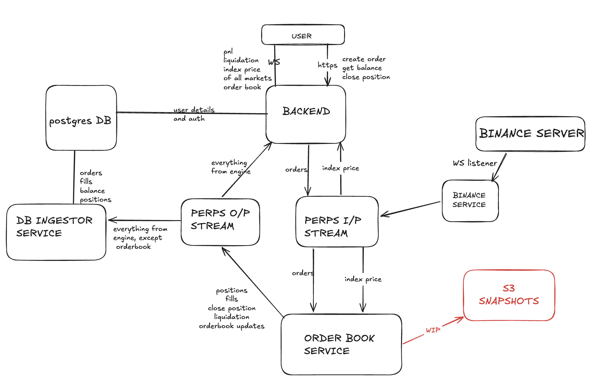

# Python Perps

A small perpetuals exchange backend built with FastAPI, Redis streams, background FastStream services, and SQLAlchemy persistence.

The complete local runtime is managed with Docker Compose. 

## Architecture



## Services

| Service | Purpose |
| --- | --- |
| `postgres` | Local Postgres database container. |
| `redis` | Redis broker used for streams and service communication. |
| `fastapi` | HTTP and WebSocket API exposed on port `8000`. |
| `binance` | Publishes market price updates into Redis streams. |
| `orderbook` | Consumes exchange events and updates order/position state. |
| `db_ingestor` | Consumes update events and writes projections to the database. |
| `liquidity_bot` | Signs in deterministic bot users and continuously places/closes randomized orders for live demo activity. |

## Requirements

- Docker
- Docker Compose
- `uv` for local Python test commands

## Environment

Create a `.env` file in the project root before starting the stack.

Required keys:

```env
DATABASE_URL=sqlite+aiosqlite:///./test.db
JWT_SECRET=replace-me
POSTGRES_USER=python_perps
POSTGRES_PASSWORD=python_perps
POSTGRES_DB=python_perps
POSTGRES_PORT=5432
```

Compose stores API and account projections in one shared SQLite database at
`/data/python_perps.db`. The named `db_data` volume keeps this database across
container restarts. Set `COMPOSE_DATABASE_URL` only when pointing both services
at another shared database URL supported by the installed SQLAlchemy driver.

Optional bot tuning:

```env
BOT_COUNT=10
BOT_STARTING_BALANCE=5000
BOT_MIN_SLEEP_SECONDS=1.5
BOT_MAX_SLEEP_SECONDS=7
```

Optional backend CORS settings:

```env
# Comma-separated list of exact allowed origins.
CORS_ALLOW_ORIGINS=https://perpetual-trading-system.pushpitkamboj.com,http://localhost:5173,http://localhost:5174

# Leave unset to keep local localhost/127.0.0.1 ports allowed by default.
# Set to an empty string to disable regex-based origin matching.
CORS_ALLOW_ORIGIN_REGEX=
```

When running a service outside Compose, it reads `DATABASE_URL` directly. The
Postgres container is available for a future shared-database configuration.

The frontend source is not included in this checkout. For a separately built
Vite frontend, configure its backend URL to a stable, reachable API host and
allow the frontend origin in `CORS_ALLOW_ORIGINS`. Avoid using an ephemeral
development tunnel for a published frontend.

## Quick Start

Start the whole stack:

```bash
make up
```

Start it in the background:

```bash
make up-d
```

Open the API:

```text
http://127.0.0.1:8000
```

Stop everything:

```bash
make down
```

## Common Commands

```bash
make help          # Show available commands
make build         # Build all app images
make up            # Build and run the stack
make up-d          # Build and run the stack in the background
make logs          # Follow logs for all services
make logs SERVICE=fastapi
make ps            # Show container status
make restart       # Restart the stack
make redis-cli     # Open redis-cli in the Redis container
make shell-api     # Open a shell in the FastAPI container
make test          # Run local tests
make test-e2e      # Run e2e tests against Docker Compose
make clean         # Stop containers and remove volumes
```

## API Flow

1. Clients call the FastAPI service.
2. FastAPI publishes exchange events to Redis stream `perps`.
3. `orderbook` consumes `perps`, applies exchange logic, and publishes results to `perps_updates`.
4. FastAPI and `db_ingestor` consume `perps_updates`.
5. FastAPI pushes live updates over WebSocket, while `db_ingestor` stores projections.
6. The orderbook engine owns in-memory collateral balances. Deposit/withdraw commands are acknowledged by HTTP, then accepted or rejected through private WebSocket `balance_update` events.
7. The `liquidity_bot` service creates realistic background exchange activity for the frontend by placing and occasionally closing orders as 10 bot users.

Market orders use their submitted price as an execution guard. They consume
crossing liquidity immediately and cancel any unfilled remainder. Limit orders
that cannot afford the actual maker-price margin are canceled with a terminal
private event instead of being left in the book.

## Testing

Run the normal test suite:

```bash
make test
```

Run end-to-end tests:

```bash
make test-e2e
```

The e2e tests recreate the relevant Docker services unless `E2E_SKIP_RECREATE=1` is set.

## Troubleshooting

Check resolved Compose configuration:

```bash
make config
```

Follow logs for one service:

```bash
make logs SERVICE=orderbook
```

Reset containers and volumes:

```bash
make clean
make up
```

If port `8000`, `6379`, or `5432` is already in use, stop the conflicting local process or change the published port in `docker-compose.yml`.
