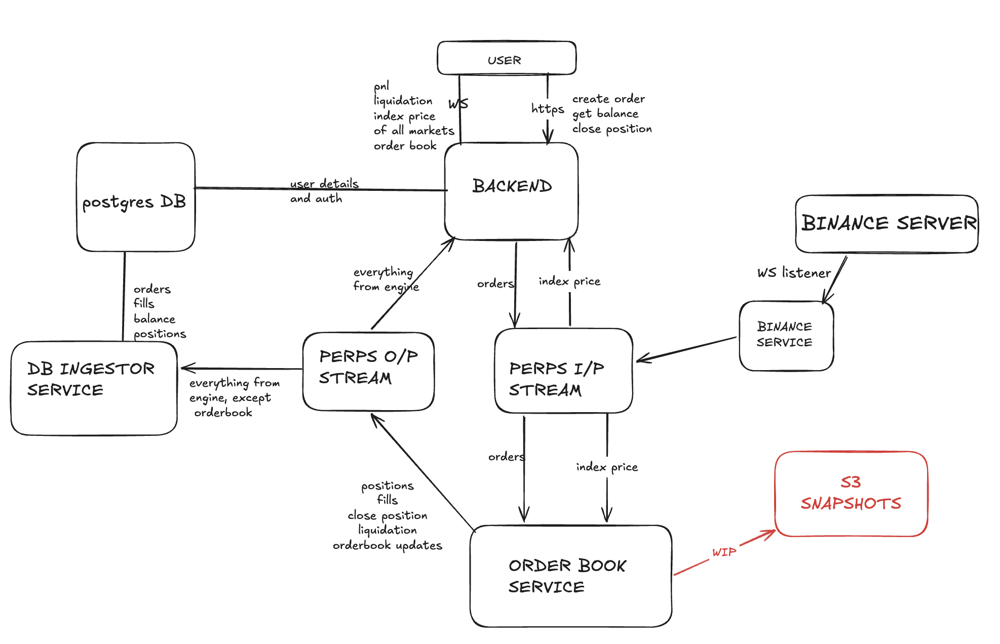
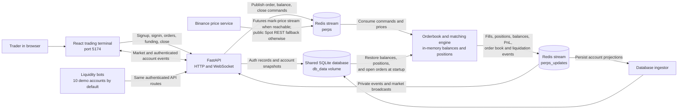

# Python Perps

A small perpetuals exchange backend built with FastAPI, Redis streams, background FastStream services, and SQLAlchemy persistence.

The complete local runtime is managed with Docker Compose. 

## Architecture



## Services

| Service | Purpose |
| --- | --- |
| `postgres` | Local Postgres database container. |
| `redis` | Redis broker used for streams and service communication. |
| `fastapi` | HTTP and WebSocket API exposed on port `8000`. |
| `binance` | Publishes market price updates into Redis streams. |
| `orderbook` | Consumes exchange events and updates order/position state. |
| `db_ingestor` | Consumes update events and writes projections to the database. |
| `liquidity_bot` | Signs in deterministic bot users and continuously places/closes randomized orders for live demo activity. |
| `frontend` | Local React trading terminal served at `http://127.0.0.1:5174`. |

## Requirements

- Docker
- Docker Compose
- `uv` for local Python test commands

## Environment

Create a `.env` file in the project root before starting the stack.

Required keys:

```env
DATABASE_URL=sqlite+aiosqlite:///./test.db
JWT_SECRET=replace-me
POSTGRES_USER=python_perps
POSTGRES_PASSWORD=python_perps
POSTGRES_DB=python_perps
POSTGRES_PORT=5432
```

Compose stores API and account projections in one shared SQLite database at
`/data/python_perps.db`. The named `db_data` volume keeps this database across
container restarts. Set `COMPOSE_DATABASE_URL` only when pointing both services
at another shared database URL supported by the installed SQLAlchemy driver.

Optional bot tuning:

```env
BOT_COUNT=10
BOT_STARTING_BALANCE=5000
BOT_MIN_SLEEP_SECONDS=1.5
BOT_MAX_SLEEP_SECONDS=7
BOT_CROSS_PROBABILITY=0.35
ENABLE_SIMULATED_PRICE_FALLBACK=true
BINANCE_HTTP_TIMEOUT_SECONDS=2
SIMULATED_BTC_PRICE=69000
SIMULATED_ETH_PRICE=1940
SIMULATED_PRICE_VOLATILITY_BPS=2
```

Optional backend CORS settings:

```env
# Comma-separated list of exact allowed origins.
CORS_ALLOW_ORIGINS=https://perpetual-trading-system.pushpitkamboj.com,http://localhost:5173,http://localhost:5174

# Leave unset to keep local localhost/127.0.0.1 ports allowed by default.
# Set to an empty string to disable regex-based origin matching.
CORS_ALLOW_ORIGIN_REGEX=
```

When running a service outside Compose, it reads `DATABASE_URL` directly. The
Postgres container is available for a future shared-database configuration.

The frontend uses `VITE_API_BASE_URL` and `VITE_WS_BASE_URL` at build time. In
local Compose, the frontend uses same-origin `/api` and `/api/ws` routes, which
Nginx proxies to FastAPI. For a separate deployment, either keep that proxy
pattern or configure reachable API URLs and allow the frontend origin in CORS.

## Quick Start

Start the whole stack:

```bash
make up
```

Start it in the background:

```bash
make up-d
```

Open the API:

```text
http://127.0.0.1:8000
```

Open the local trading terminal:

```text
http://127.0.0.1:5174
```

To share the full stack over the internet for a temporary demo, start ngrok:

```bash
ngrok http 5174
```

Open the HTTPS forwarding URL printed by ngrok. The frontend proxies `/api` and
WebSocket requests to FastAPI on the same hostname, so the API does not need a
separate public URL. The API port is bound to localhost; keep the ngrok process
running while the demo is in use. Ngrok's free domain may show a warning screen
on first visit; choose **Visit Site** to continue.

Create a paper account, add or withdraw demo collateral, and place limit orders.
The market feed tries Binance Futures mark prices, then Binance's public Spot
endpoint as an index proxy. If external market data is unreachable, local Compose
publishes a small random walk around `SIMULATED_BTC_PRICE` and
`SIMULATED_ETH_PRICE`; the terminal labels this source as simulated. Orders and
fills are always simulated by the local matching engine.

Stop everything:

```bash
make down
```

## Common Commands

```bash
make help          # Show available commands
make build         # Build all app images
make up            # Build and run the stack
make up-d          # Build and run the stack in the background
make logs          # Follow logs for all services
make logs SERVICE=fastapi
make ps            # Show container status
make restart       # Restart the stack
make redis-cli     # Open redis-cli in the Redis container
make shell-api     # Open a shell in the FastAPI container
make test          # Run local tests
make test-e2e      # Run e2e tests against Docker Compose
make clean         # Stop containers and remove volumes
```

## End-to-end Workflow

The diagram shows the local paper-trading path. `perps` carries commands and incoming prices; `perps_updates` carries exchange results to the API and database writer.



### What happens end to end

1. **The browser connects.** The React terminal loads from the frontend container. It opens a public market WebSocket for prices and order-book depth. After sign-in, it opens a second WebSocket with its JWT for private account updates and an initial balance/position snapshot.
2. **The user signs up or signs in.** FastAPI validates credentials and stores or reads the account record in the shared database. It returns a JWT. Authenticated requests and the private WebSocket use that token to identify the account.
3. **Prices reach the terminal.** The Binance service first tries Binance Futures mark-price WebSocket data. If that feed is unreachable, it polls Binance's public Spot ticker endpoint and maps BTCUSDT and ETHUSDT to BTC-PERP and ETH-PERP index proxies. If the host has no external market-data access, local Compose publishes an explicitly labeled simulated price stream. Each update goes to Redis stream `perps`; the matching engine uses prices to update unrealized PnL and check liquidation levels. FastAPI forwards prices and market depth to subscribed browsers.
4. **Demo funds enter or leave the account.** The browser sends an authenticated onramp or offramp request. FastAPI acknowledges the request and publishes it to `perps`. The matching engine checks the demo wallet or available collateral, applies the balance change if valid, and publishes a `balance_update` event. FastAPI sends the result to that user's private WebSocket, and the database ingestor saves the account projection.
5. **An order is checked and matched.** FastAPI validates the authenticated limit-order request and publishes it to `perps`. The matching engine checks available margin, reserves collateral, then matches it against eligible opposing orders by price and time. A limit order that does not cross remains open in the book. A market order uses its submitted price as an execution guard and cancels any unfilled remainder.
6. **Fills update both traders.** For each match, the engine creates fill records, updates each participant's position and collateral, and publishes order-book and private account events to `perps_updates`. FastAPI broadcasts the changed book and sends each participant their own order, fill, position, and balance updates. The database ingestor persists fills and account projections.
7. **Positions can close or liquidate.** A close request travels through the same API and Redis command stream. The engine matches the position against available book liquidity, realizes PnL, releases margin, and publishes the resulting account event. Price updates also trigger PnL and liquidation checks. The engine restores balances, positions, and open orders from saved projections on startup.
8. **Bots create demo activity.** The `liquidity_bot` signs in as demo users and submits orders or close requests through the same API. Their orders use the same matching engine and appear in market depth; any trades are simulated paper fills.

**Execution note:** prices are public market data when an exchange feed is reachable; otherwise the configured local simulated feed is used and labeled in the terminal. Trades are always local paper trades. Binance does not receive or execute these orders, and no real funds move.

Market orders use their submitted price as an execution guard. They consume
crossing liquidity immediately and cancel any unfilled remainder. Limit orders
that cannot afford the actual maker-price margin are canceled with a terminal
private event instead of being left in the book.

## Testing

Run the normal test suite:

```bash
make test
```

Run end-to-end tests:

```bash
make test-e2e
```

The e2e tests recreate the relevant Docker services unless `E2E_SKIP_RECREATE=1` is set.

## Troubleshooting

Check resolved Compose configuration:

```bash
make config
```

Follow logs for one service:

```bash
make logs SERVICE=orderbook
```

Reset containers and volumes:

```bash
make clean
make up
```

If port `8000`, `6379`, or `5432` is already in use, stop the conflicting local process or change the published port in `docker-compose.yml`.
